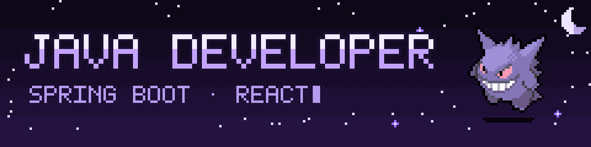

  

Full-stack developer from Brazil. I build web applications end to end: **Java / Spring Boot** APIs, **React / TypeScript** front-ends, and the infrastructure to ship them. Getting into open source.

  
  
  
  
  
  

<picture>
  <source media="(prefers-color-scheme: dark)" srcset="https://raw.githubusercontent.com/JooaoGui/JooaoGui/output/github-snake-dark.svg">
  
</picture>

Banner: original pixel fan art of Gengar. Pokémon © Nintendo / Creatures / GAME FREAK; not affiliated or endorsed.
