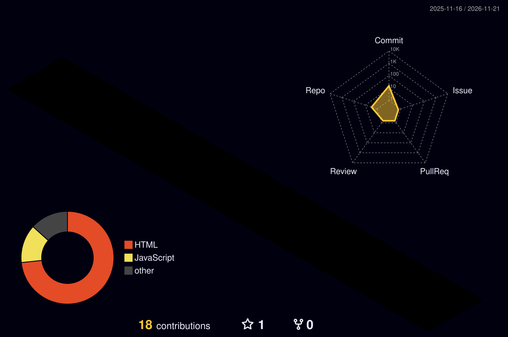

  

### Hi, I'm João 👋

Full-stack developer from Maranhão, Brazil. I build web applications end to end: **Java / Spring Boot** APIs, **React / TypeScript** front-ends, and the infrastructure to ship them.

- 🔭 Building production systems for real clients, from database to deploy
- 🌱 Getting into open source, looking for Java and TypeScript projects to contribute to
- 💬 Ask me about Spring Boot, React, Docker and self-hosting on a Linux VPS

### 🛠️ Tech

  
  
  
  
  
  
  
  
  
  
  

### 🕹️ Contributions

<picture>
  <source media="(prefers-color-scheme: dark)" srcset="https://raw.githubusercontent.com/JooaoGui/JooaoGui/output/github-snake-dark.svg">
  
</picture>

<picture>
  <source media="(prefers-color-scheme: dark)" srcset="https://raw.githubusercontent.com/JooaoGui/JooaoGui/output/pacman-contribution-graph-dark.svg">
  
</picture>

  

